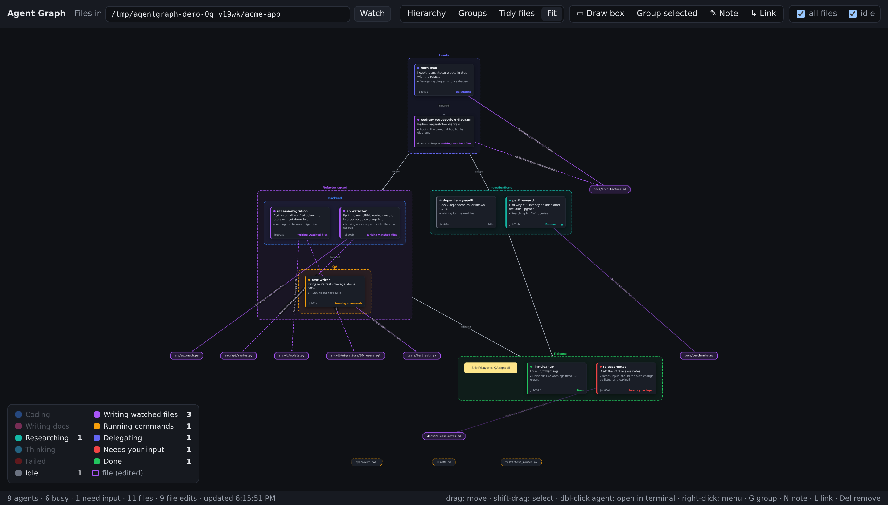

# agentgraph

A live, editable graph of the [Claude Code](https://claude.com/claude-code) agents running on your machine, and
the files they are changing.



*Made-up agents from `scripts/demo.py`, arranged with boxes (Backend and QA nested inside Refactor squad),
group-to-group hierarchy links, a note, and the **Hierarchy** layout.*

- **Agent nodes** (cards). The title is the agent's name and id. The body says what the agent is working toward,
  plus its current step (`▸ …`). The colour shows what it is doing right now. The legend counts how many agents
  are in each state; click a legend entry to jump to those agents.
- **File nodes** (cut-corner boxes). These are the files inside a folder you choose.
- **Edges** (agent → file). An edge means the agent edited that file in the last 15 minutes. The label says what
  the change was for. Edges written in the last minute are animated, and older ones fade out.
- **Hierarchy links** (dashed arrows). Parent → subagent links are detected automatically, and you can draw your
  own.
- **Boxes and notes.** Group nodes into boxes (boxes can nest), and add sticky-note annotations. Your layout is
  saved.
- **Click to attach.** Double-click a background agent to open a terminal running `claude attach <id>`.
- **Finished jobs stay visible.** Background jobs that are done, failed or waiting for you stay on the graph for
  24 hours after their process exits.

> **Unofficial.** This is a community tool, not an Anthropic product. It reads Claude Code's local state files
> (`~/.claude/sessions`, `jobs`, `projects`). Those files are internal and undocumented, so a Claude Code update
> may break it. Everything stays on your machine; the server only listens on `127.0.0.1` by default.

## Install

You need Python 3.9 or newer and Claude Code. It works on Linux and macOS.

```bash
git clone https://github.com/<you>/agentgraph.git
cd agentgraph
pip install -e .          # installs Flask and an `agentgraph` command
```

If you'd rather not install it, run `pip install flask` and use `python3 -m agentgraph` from the repo folder.

To try it without any agents running, `python3 scripts/demo.py` serves the made-up graph from the screenshot at
<http://127.0.0.1:8766>.

## Run

```bash
agentgraph --dir ~/path/to/project --open        # foreground, Ctrl-C to stop
agentgraph --dir ~/path/to/project --background  # detach and return
agentgraph --dir ~/path/to/project --summarize   # AI-written purposes / edit labels
```

Then open <http://127.0.0.1:8765>. You can change the watched folder from the toolbar, and the last folder you
used is remembered.

| flag | meaning |
|---|---|
| `--dir PATH` | Folder whose files become nodes (searched 3 levels deep by default, `--depth N` to change). Dotfiles, `.git` and `node_modules` are skipped. |
| `--summarize` | Use `claude -p --model haiku` to write the purpose text and edge labels. It runs on your normal Claude login, so no API key is needed. Results are cached in `~/.cache/agentgraph/`. `--model` picks another model. |
| `--edge-window MIN` | How long an edit edge stays visible (default 15). |
| `--keep-finished HOURS` | How long exited background jobs stay on the graph (default 24, `0` hides them). |
| `--terminal TPL` | Terminal used for attaching, e.g. `'kitty -e {cmd}'`. By default it auto-detects gnome-terminal, kitty, wezterm, alacritty, konsole, xterm, … and Terminal.app on macOS. |
| `--port`, `--host` | Where to serve (default `127.0.0.1:8765`). |
| `--layout FILE` | Where boxes, notes and positions are saved (default `~/.config/agentgraph/layout.json`). |
| `--dump` | Print one JSON snapshot and exit, for debugging. |

### Open it from Claude

```bash
agentgraph --install-skill [--dir ~/path/to/project]
```

This installs `~/.claude/skills/agent-graph/SKILL.md`. Typing `/agent-graph` in any Claude session, including
one you start from `claude agents`, starts the server if needed and opens the browser. Delete that folder to
remove the skill.

### Keep it running (Linux, systemd)

```bash
agentgraph --install-service --dir ~/path/to/project --summarize
loginctl enable-linger $USER     # optional: start at boot, not only after you log in
```

This writes `~/.config/systemd/user/agentgraph.service` using your current Python, `PATH`, `DISPLAY` and
flags, then enables and starts it. To run with different flags, run the command again with them. To remove it:

```bash
systemctl --user disable --now agentgraph && rm ~/.config/systemd/user/agentgraph.service
```

Logs: `journalctl --user -u agentgraph -f`.

### View it from another computer

The server only listens on localhost, so reach it through an SSH tunnel rather than opening the port:

```bash
ssh -L 8765:127.0.0.1:8765 you@agent-machine
```

Then browse to <http://127.0.0.1:8765> on the computer you're sitting at. To make the tunnel automatic, add this
to `~/.ssh/config` there:

```
Host agent-machine
    HostName agent-machine.example.com   # or its IP / Tailscale address
    User you
    LocalForward 8765 127.0.0.1:8765
```

Double-click-to-attach opens the terminal on the machine running the server, not on the one you're viewing from.
Over SSH, use the *Copy* button in the side panel and run `claude attach <id>` in your SSH session instead.

## Using the graph

| do this | to |
|---|---|
| drag a node | move it (positions are saved) |
| drag a node into or out of a box | change its group |
| shift-drag on the background | select several nodes |
| **▭ Draw box** (`B`), then drag a rectangle | box everything inside it |
| **Group selected** (`G`) | box the selected nodes; boxes can be nested |
| **✎ Note** (`N`), or right-click the background | add an annotation; edit it in the side panel |
| select parent, then child, then **↳ Link** (`L`) | add a hierarchy link (between agents or boxes) |
| **Hierarchy** (`H`) | top-down layered layout that follows the links, inside and between boxes |
| **Groups** | force layout that keeps each box together |
| **Tidy files** | line the file nodes up in a grid |
| click | details panel: purpose, current step, recent tool calls, edits, original prompt |
| double-click an agent | open it in a terminal (`claude attach`) |
| right-click | context menu: attach, copy the attach command, move into a box, link, hide, … |
| `Delete` | remove the selected box (its contents stay), note or link; hide the selected agent or file |

### Colours

| category | meaning |
|---|---|
| Coding | last tool call wrote a code or config file |
| Writing watched files | last tool call wrote a file in the folder you are watching (these also draw edges) |
| Writing docs | wrote a non-code file somewhere else |
| Running commands | Bash |
| Researching | Read / Grep / Glob / WebSearch / WebFetch |
| Delegating | spawned or messaged a subagent |
| Thinking | busy, with no tool call in the last 2 minutes |
| Needs your input / Failed / Done / Idle | from the job state |

To change the colours, edit `CATS` at the top of `agentgraph/static/app.js`.

## How it works

A small Flask server polls Claude Code's own state files and the browser redraws the graph every 2 seconds. It
reads `$CLAUDE_CONFIG_DIR` if set, otherwise `~/.claude`:

- `sessions/<pid>.json`: one file per running Claude process (name, busy/idle, job id). Dead pids and
  pre-warmed spare workers are ignored.
- `jobs/<id>/state.json` and `timeline.jsonl`: a background job's task, its current step and its result.
- `projects/<slug>/<session>.jsonl`: the transcript. It is tailed incrementally, and its
  `Write`/`Edit`/`MultiEdit`/`NotebookEdit` calls, plus shell redirects such as `> file` and `tee file`, become
  edges.
- `projects/<slug>/<session>/subagents/agent-*.jsonl`: subagents, which appear as child nodes.

Without `--summarize`, an edge is labelled with what the agent said just before the edit. If it said nothing,
the label falls back to the job's current step, and then to a mechanical summary such as "edited 3→7 lines".

The front end is plain JavaScript on [Cytoscape.js](https://js.cytoscape.org/). The libraries are vendored, so
nothing is fetched from a CDN (see [THIRD_PARTY_NOTICES.md](THIRD_PARTY_NOTICES.md)).

## Limitations

- An already-open `claude agents` screen can't be told to jump to an agent; Claude Code has no API for that.
  Clicking a node therefore opens a new terminal running `claude attach <id>`. Its `←` key takes you to the agent
  view, and the panel also has a *Copy* button for the command.
- Interactive (non-background) sessions can't be attached. Their panel shows which TTY they are running on.
- Shell writes are found by pattern-matching redirects, so unusual commands can be missed.
- Windows is untested.

## Development

```bash
pip install -e '.[test]'
python3 -m pytest tests          # add PYTEST_DISABLE_PLUGIN_AUTOLOAD=1 if unrelated pytest plugins get in the way
python3 scripts/demo.py          # UI on fake data at http://127.0.0.1:8766
```

The tests build a fake Claude config dir in a temp folder, so they never touch your real one.

## License

MIT, see [LICENSE](LICENSE).
